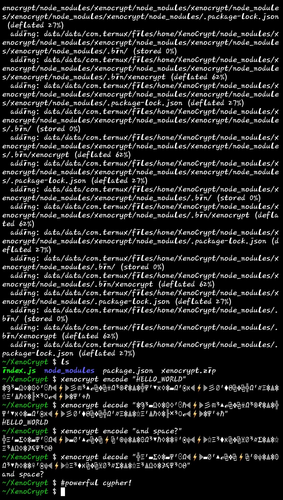

# XenoCrypt 🛸

**Keyless, non-linear chaotic hyper-glyph cryptographic engine.**

XenoCrypt transforms plain text into dense, non-human-readable alien glyph streams using deterministic IEEE-754 chaotic state mixing and 5-matrix hyper-glyph decomposition. Built for zero-dependency execution across Node.js, Termux, and cross-language runtimes.

---

## ✨ Features

* **Keyless Chaotic Diffusion:** Multi-round sinusoidal phase-space byte mixing (`Math.sin` chaotic maps) combined with bitwise rotations eliminates frequency analysis and human pattern recognition.
* **5-Matrix Hyper-Glyph Decomposition:** Maps every byte across five distinct symbol tables (**Anchor**, **Core**, **Flux**, **Phase**, and **Nexus**) separated by non-Euclidean delimiters (`⟡⎈`, `⫷⚡⫸`, `⧉❖⧉`, `⎈⟁⎈`).
* **Global Runtime & CLI Ready:** Works both as an interactive terminal command (`xenocrypt`) and a globally accessible Node.js module (`CosmicHyperGlyphCodex`).
* **Cross-Language Parity:** Uses standard IEEE-754 double-precision floating-point arithmetic, ensuring payloads encoded in JavaScript decode identically in Python and vice versa.

---

## 🚀 Installation

### Option 1: From Compressed Archive (`.zip`)
If you downloaded the standalone `xenocrypt.zip` archive to your device, decompress it and install globally:

```bash
unzip xenocrypt.zip -d XenoCrypt
cd XenoCrypt
npm install
npm install -g .